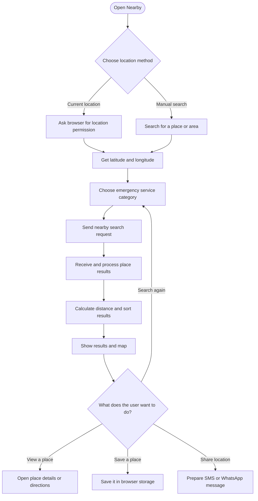
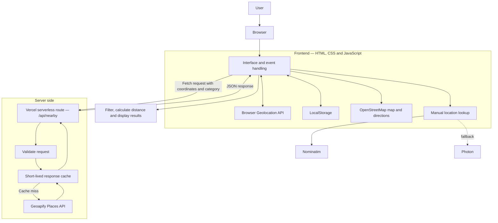

# Nearby — Smart Location-Based Emergency Assistance

> A simple web app that helps people find useful emergency services around a selected location, without having to search across multiple websites.

**CSE326 — Internet Programming Project**  
**Project title:** Nearby: A Smart Location-Based Emergency Assistance Web Application  
**Live application:** https://nearby-emergency-assistance.vercel.app  
**Source code:** https://github.com/devanshshukla-3004/Nearby-Emergency-Assistance

---

## About the project

In an emergency, finding the right nearby facility quickly can be difficult. A person may need to locate a hospital, pharmacy, police station or fire station, but searching for each service separately takes time.

**Nearby brings these searches together in one place.** The user can share their current location or enter a place manually, choose the type of service they need, and view nearby results with distance and map directions.

The project is designed as a practical location-based web application. It focuses on making nearby information easier to find and use. It is an information tool, not an emergency-response or dispatch system.

## What you can do with Nearby

- **Find nearby services:** Search for hospitals, clinics, pharmacies, police stations, fire stations and ambulance stations.
- **Use your current location:** Allow browser location access to search around your present position.
- **Enter a location manually:** Search for another area when you do not want to use your current location.
- **Browse and filter results:** Narrow results by service category or text search. Results are sorted by distance.
- **View map directions:** Open a selected place on the map and get directions.
- **Keep useful places handy:** Save emergency places in the browser for later reference.
- **Manage trusted contacts:** Store contact details locally and prepare a location-sharing message.
- **Use emergency shortcuts:** Open the phone dialler with the 112 call shortcut.
- **Use it on different screens:** The layout adapts to desktop and mobile screens.

The nearby search is configured for a **5 km radius** and can display **up to 200 results**. A scrollable results panel keeps longer lists manageable.

## How the application works

At a high level, the user selects a location, Nearby requests relevant place data, and the results are displayed with distance and map links.

### 1. User flow

### 2. Application architecture

The application uses a small frontend and a server-side API route. The browser handles the interface and user interactions. The server-side route communicates with Geoapify so the API key does not need to be exposed in frontend code.

### 3. Nearby search request

1. The browser obtains coordinates from the Geolocation API, or the user selects a manually searched location.
2. The frontend sends the coordinates and selected service category to `/api/nearby`.
3. The server route validates the request and checks its short-lived cache.
4. If a fresh cached response is not available, the route requests place data from Geoapify.
5. The route returns the results as JSON. The frontend processes and displays them.

The Geoapify key is kept in a Vercel environment variable named `GEOAPIFY_API_KEY`. It is not intended to be placed in browser JavaScript or committed to this repository.

## Technology used

The project uses browser technologies and JavaScript concepts that are relevant to an Internet Programming course, along with external services for maps and place data.

| Technology | Where it is used |
|---|---|
| HTML5 | Page structure, forms, links and semantic elements |
| CSS3 | Layout, responsive styling, Flexbox, Grid, focus states and media queries |
| JavaScript | Application logic, functions, arrays, objects, validation and DOM events |
| DOM API | Updating the page and responding to user actions |
| Geolocation API | Asking the browser for the user's current coordinates |
| Fetch API | Sending requests to the application API and location search providers |
| JSON | Sending and receiving structured API data |
| Web Storage API | Saving contacts, places, theme preference and cached results in the browser |
| Node.js serverless function | Handling nearby-service requests on the server |
| Geoapify Places API | Supplying nearby place information |
| Nominatim and Photon | Looking up manually entered locations |
| OpenStreetMap | Map display and directions links |
| Vercel | Hosting the frontend and serverless API |
| Git and GitHub | Source control and project collaboration |

**Data storage:** Nearby does not currently use a dedicated database. Saved contacts, saved places, theme preference and the local result cache are stored in the user's browser using LocalStorage.

## Project setup

The complete application is intended to run on Vercel because the nearby-service search uses the server-side `/api/nearby` route. Opening `index.html` directly, or hosting only the static files on GitHub Pages, will not provide that API route.

### Requirements

- A GitHub account
- A free Geoapify account and API key
- A Vercel account connected to the repository

### Deploy your own copy

1. Fork or clone this repository.
2. Create a Geoapify project at https://myprojects.geoapify.com/ and generate an API key.
3. Import the repository into Vercel.
4. Open **Project Settings → Environment Variables**.
5. Add `GEOAPIFY_API_KEY` and paste your Geoapify key as its value. Enable it for the environments you plan to use, such as Preview and Production.
6. Deploy the project.
7. Open the deployed HTTPS URL, allow location access or use the manual location search, and try a nearby-service search.

**Keep your API key private.** Do not paste it into `script.js`, HTML, a public environment variable, screenshots, or Git commits. If a key is accidentally exposed, rotate it in the Geoapify dashboard.

## Repository

The source code is maintained in this GitHub repository:

https://github.com/devanshshukla-3004/Nearby-Emergency-Assistance

The deployed application is available here:

https://nearby-emergency-assistance.vercel.app

## Privacy, reliability and safety

A location-based application needs to be clear about what it does with location and third-party data.

- **Location permission:** The browser asks the user before sharing their current location. Manual location search is available as an alternative.
- **Browser storage:** Saved contacts, saved places, theme preference and cached results are stored locally in the browser. They are not synced to an account or database.
- **Location requests:** The selected coordinates are sent to the app's server-side nearby-search route to retrieve local place information.
- **Third-party data:** Place information comes from external providers and may be incomplete or out of date. Phone numbers, addresses and operating status should be checked before relying on them.
- **Provider availability:** Geoapify quotas and service availability apply. If the provider is unavailable or a quota is exceeded, a search may fail; cached results may be shown when available.
- **No emergency dispatch:** Nearby does not contact emergency services, dispatch an ambulance or guarantee a response.
- **User-controlled messages:** The app prepares SMS or WhatsApp links for the user to review and send. It does not silently send messages.
- **Emergency number:** In India, call **112** for urgent emergency assistance. Do not rely on this app instead of contacting official emergency services.

## External services and attribution

Nearby uses the following external services:

- **Geoapify Places API** for nearby service listings.
- **Nominatim** and **Photon** for manual location lookup.
- **OpenStreetMap** for map display and directions.

These services have their own terms, attribution requirements, rate limits and availability conditions. Please check the providers' current documentation before deploying your own copy or making significant changes.

## Ideas and concepts to explain in the viva

You do not need to memorise the README. Make sure you can explain the parts you worked on and why they are used.

| Topic | What you should be able to explain |
|---|---|
| Geolocation | How `navigator.geolocation.getCurrentPosition()` obtains coordinates after permission |
| Fetch and APIs | How the frontend sends an HTTP request and receives a response |
| JSON | How API data is parsed and used by JavaScript |
| DOM manipulation | How JavaScript updates result cards, messages and interface elements |
| Arrays and objects | How place results are represented and processed |
| `filter()`, `map()` and `sort()` | How results can be filtered, transformed and ordered |
| Distance calculation | How coordinates are used to calculate distance between two locations |
| LocalStorage | How the browser saves and retrieves small pieces of user data |
| Validation and errors | How invalid input, failed requests and timeouts are handled |
| Responsive design | How CSS media queries, Flexbox and Grid adapt the interface |
| Serverless API | Why the nearby search is routed through `/api/nearby` |
| Environment variables | Why the Geoapify API key is kept on the server |
| Data limitations | Why third-party place listings should be verified |

## Project evaluation and demonstration

For a clear demonstration, you can follow this order:

1. Open the live application.
2. Allow location access or search for a location manually.
3. Search for a hospital, pharmacy or another available service category.
4. Show the result list, distance sorting and category/text filtering.
5. Open a place on the map or use its directions link.
6. Demonstrate saving a place and managing a trusted contact.
7. Show the location-sharing message preparation and explain that the user sends it manually.
8. Briefly explain the architecture and the role of the server-side API route.

## Limitations and possible future improvements

The current version focuses on finding and using nearby place information. Some improvements that could be explored later include:

- More robust handling of unavailable third-party providers.
- Better ways to verify and report incorrect place information.
- Optional support for additional regions and languages.
- Further accessibility testing with assistive technologies.
- A secure backend account system if cross-device synchronisation is needed.

These are possible future improvements, not features that the current version claims to provide.

---

*Built as a CSE326 Internet Programming project. The goal is straightforward: make nearby emergency-service information easier to find, while being honest about the limits of third-party data and what the application can actually do.*
